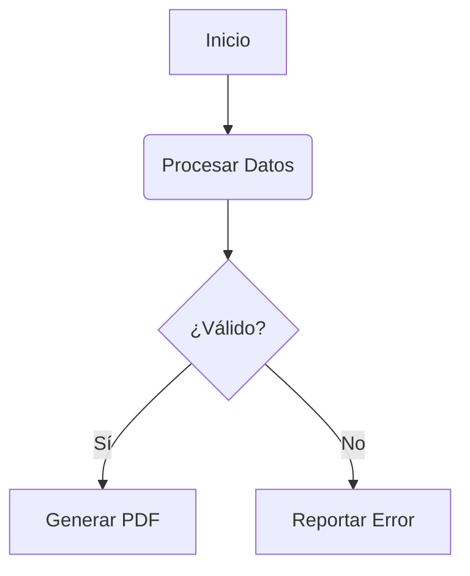

# MDToPDF 📄✨

**MDToPDF** es un sistema integral de transformación de documentos **Markdown (.md) a PDF** diseñado con un enfoque obsesivo en la **máxima fidelidad semántica** y la **estética visual editorial**.

---

## 🌟 Características Destacadas

- 📐 **Fórmulas Matemáticas de Alta Precisión**: Soporte nativo para KaTeX en línea (`$E = mc^2$`) y en bloque (`$$\int f(x) dx$$`).
- 📊 **Diagramas Vectoriales Mermaid**: Soporte directo para diagramas de flujo, diagramas de secuencia, mapas mentales y diagramas de clases embebidos.
- 💬 **GitHub Callouts & Alertas**: Soporte estilizado para `[!NOTE]`, `[!TIP]`, `[!IMPORTANT]`, `[!WARNING]` y `[!CAUTION]` con iconos SVG integrados.
- 🎨 **5 Temas Visuales Profesionales**:
  - `modern`: Tipografía contemporánea, espaciados generosos, paleta indigo/slate (estilo tech Stripe/Vercel).
  - `academic`: Tipografía serif clásica, texto justificado, tablas académicas APA/IEEE sin líneas verticales.
  - `editorial`: Estilo revista/libro premium, cabeceras elegantes y acentos cálidos.
  - `minimal`: Estilo suizo/Bauhaus en blanco y negro, precisión geométrica.
  - `dark`: Modo oscuro tecnológico de alto contraste.
- 📑 **Portadas Editoriales Automáticas**: Generación de páginas de portada profesionales con título, subtítulo, autor, organización, versión y fecha extraídos automáticamente de metadatos YAML frontmatter.
- 🔢 **Encabezados y Pies de Página Dinámicos**: Numeración de páginas inteligente (*"Página X de Y"*), títulos de sección y fechas.
- 🖨️ **Control de Impresión y Paginación**: Reglas anti-huérfanas (*break-inside: avoid* en tablas, títulos y bloques de código) y soporte para saltos de página manuales con `<!-- pagebreak -->`.
- 🔌 **100% Autónomo y Offline**: No requiere servicios en la nube, ni instalaciones pesadas de Pandoc o LaTeX. Utiliza el motor Chromium/Edge preinstalado en tu sistema.
- 💻 **Doble Modo de Operación**: Potente CLI para terminal y Servidor Web interactivo para edición y vista previa en tiempo real.

---

## 🚀 Instalación y Requisitos

Requiere **Node.js (>= 18)** y cualquier navegador basado en Chromium (Microsoft Edge viene incluido por defecto en Windows 10/11, o Google Chrome/Brave).

```bash
# Dentro de la carpeta del proyecto:
npm install
```

---

## 📖 Modo de Uso

### 1. Vía CLI (Línea de Comandos)

Convertir un archivo Markdown a PDF con el tema predeterminado (`modern`):

```bash
node ./bin/mdtopdf.js ./examples/demo-showcase.md
```

#### Opciones Disponibles:

```bash
node ./bin/mdtopdf.js <archivo.md> [salida.pdf] [opciones]
```

| Opción | Descripción | Valor por defecto |
| :--- | :--- | :---: |
| `-t, --theme <tema>` | Seleccionar tema (`modern`, `academic`, `editorial`, `minimal`, `dark`) | `modern` |
| `-c, --cover` | Forzar inclusión de página de portada | `false` |
| `-f, --format <formato>` | Formato de hoja (`A4`, `Letter`, `Legal`, etc.) | `A4` |
| `-l, --landscape` | Orientación apaisada / horizontal | `false` |
| `--no-header-footer` | Ocultar encabezados y pies de página | `false` |
| `--header <texto>` | Texto personalizado en el encabezado | Título |
| `--footer <texto>` | Texto personalizado en el pie de página | Título |
| `--css <archivo>` | Ruta a archivo CSS con estilos adicionales | `null` |
| `-w, --watch` | Observar el archivo y regenerar el PDF ante cambios | `false` |
| `-b, --browser <ruta>` | Ruta manual al ejecutable de Chrome o Edge | Autodetectado |

#### Ejemplos de Comandos:

```bash
# Paper académico con portada en tamaño Carta:
node ./bin/mdtopdf.js ./examples/sample-paper.md -t academic --cover -f Letter

# Modo oscuro con orientación horizontal:
node ./bin/mdtopdf.js mi-documento.md -t dark -l -o salida-oscura.pdf

# Modo vigilancia para desarrollo continuo:
node ./bin/mdtopdf.js reporte.md --watch
```

---

### 2. Modo GUI / Servidor de Vista Previa Interactiva

Para iniciar el estudio interactivo con editor de código, vista previa en tiempo real y descarga de PDF con un clic:

```bash
npm run serve
# o especificando un archivo inicial:
node ./bin/mdtopdf.js serve ./examples/demo-showcase.md
```

Abre tu navegador en `http://localhost:3000`.

---

## 📝 Guía de Sintaxis Soportada

### Metadatos YAML Frontmatter

Coloca al inicio de tu archivo `.md`:

```yaml
---
title: "Título de la Investigación"
subtitle: "Subtítulo o descripción del informe"
author: "Nombre del Autor"
organization: "Nombre de la Empresa o Institución"
date: "2026-09-25"
version: "1.0.0"
badge: "DOCUMENTO CONFIDENCIAL"
theme: "editorial"
cover: true
toc: true
format: "A4"
---
```

### Matemáticas (KaTeX)

```markdown
En línea: $E = mc^2$

En bloque:
$$f(x) = \int_{-\infty}^{\infty} \hat{f}(\xi)\,e^{2 \pi i \xi x} \,d\xi$$
```

### Diagramas (Mermaid)

````markdown

````

### Alertas / Callouts Estilo GitHub

```markdown
> [!NOTE]
> Nota informativa con contexto.

> [!TIP]
> Sugerencia o recomendación útil.

> [!IMPORTANT]
> Información crucial que no se debe pasar por alto.

> [!WARNING]
> Advertencia de posibles inconvenientes.

> [!CAUTION]
> Aviso de seguridad o precaución severa.
```

### Saltos de Página Forzados

Para iniciar una nueva página limpia:

```markdown
<!-- pagebreak -->
```

---

## 📁 Estructura del Proyecto

```
MDToPDF/
├── bin/
│   └── mdtopdf.js          # CLI ejecutable
├── src/
│   ├── browser.js          # Detección automática de Edge/Chrome nativo
│   ├── converter.js        # Compilador orquestador MD -> HTML -> PDF
│   ├── markdown.js         # Pipeline de Markdown (KaTeX, TOC, alertas, tablas)
│   ├── pdf.js              # Generación de PDF con Puppeteer headless
│   ├── server.js           # Servidor Express para GUI interactiva
│   ├── plugins/            # Plugins personalizados (katex.js, alerts.js)
│   ├── templates/          # Plantillas HTML de documento y portada
│   └── themes/             # Temas CSS (base, modern, academic, editorial, minimal, dark)
├── public/                 # Aplicación web frontend (HTML, CSS, JS)
├── examples/               # Archivos markdown de prueba y demostración
└── package.json
```
