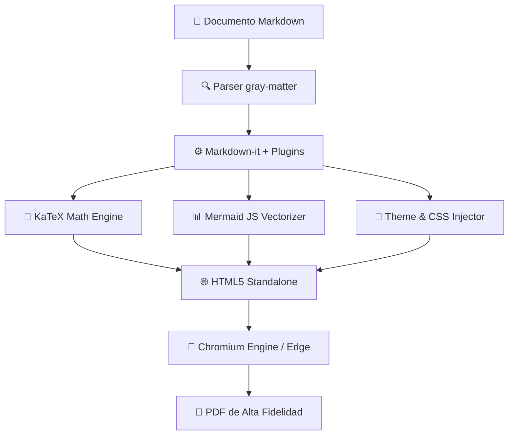
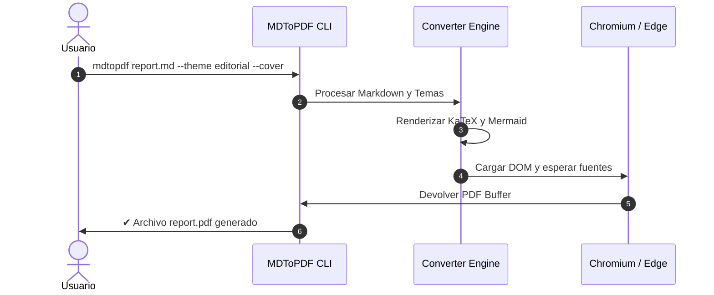

# 1. Introducción y Propósito

El proyecto **MDToPDF** nace con el objetivo de cerrar la brecha existente entre la simplicidad de redacción de los archivos Markdown (`.md`) y la exigencia estética y tipográfica que requieren los documentos PDF destinados a presentaciones ejecutivas, informes de ingeniería, libros y publicaciones académicas.

> [!NOTE]
> Este documento demuestra la fidelidad de renderizado del sistema **MDToPDF**, abarcando fórmulas matemáticas, diagramas Mermaid, tablas complejas, bloques de código estilizados y notas al pie.

## 1.1 Objetivos de Diseño

Los pilares fundamentales del motor son:

1. **Fidelidad Semántica**: Respeto riguroso de la especificación CommonMark y GitHub Flavored Markdown (GFM).
2. **Estética Editorial**: Espaciado armónico, jerarquía visual clara y múltiples temas de diseño.
3. **Autonomía Offline**: Renderizado completo sin dependencias de servicios externos en la nube.
4. **Control de Paginación**: Reglas CSS contra viudas y huérfanas, soporte de saltos de página con `<!-- pagebreak -->`.

---

# 2. Expresiones Matemáticas con KaTeX

MDToPDF integra el motor KaTeX para procesar fórmulas matemáticas tanto en línea como en bloque con la máxima nitidez vectorial.

### 2.1 Ecuaciones en Línea

La famosa equivalencia masa-energía de Einstein es $E = mc^2$. La identidad de Euler que conecta las cinco constantes matemáticas fundamentales se expresa como $e^{i\pi} + 1 = 0$. También podemos evaluar la función gamma $\Gamma(z) = \int_0^\infty t^{z-1} e^{-t} \, dt$.

### 2.2 Ecuaciones en Bloque

A continuación se presenta la transformada de Fourier para una función $f(x)$:

$$f(x) = \frac{1}{\sqrt{2\pi}} \int_{-\infty}^{\infty} \hat{f}(\xi)\,e^{i\xi x} \,d\xi$$

Y la fórmula de la distribución normal multivariada:

$$p(\mathbf{x}) = \frac{1}{\sqrt{(2\pi)^k |\mathbf{\Sigma}|}} \exp\left( -\frac{1}{2}(\mathbf{x}-\boldsymbol{\mu})^\top \mathbf{\Sigma}^{-1} (\mathbf{x}-\boldsymbol{\mu}) \right)$$

---

# 3. Diagramas de Flujo y Arquitectura con Mermaid

Los diagramas se declaran en texto claro y se compilan automáticamente a gráficos vectoriales SVG en el documento final.



### 3.1 Diagrama de Secuencia



<!-- pagebreak -->

# 4. Alertas y Callouts Estilo GitHub

Para resaltar información crítica, recomendaciones o avisos de seguridad, MDToPDF soporta la sintaxis nativa de callouts de GitHub:

> [!NOTE]
> Este es un bloque de nota informativo para aportar contexto adicional al lector sin interrumpir el flujo.

> [!TIP]
> Puedes alternar entre temas con el flag `-t` o `--theme`. Prueba `academic` para reportes formales o `editorial` para revistas.

> [!IMPORTANT]
> Puedes insertar saltos de página limpios en cualquier punto de tu documento utilizando la etiqueta `<!-- pagebreak -->`.

> [!WARNING]
> Recuerda verificar las rutas relativas de las imágenes antes de compilar para asegurar su resolución local.

> [!CAUTION]
> No ejecutes procesos que modifiquen el archivo de origen durante el modo `--watch`.

---

# 5. Tablas y Listas de Tareas

Las tablas cuentan con contenedor estilizado, cabeceras contrastadas y ajuste óptico:

| Característica | Estado | Soporte Offline | Observaciones |
| :--- | :---: | :---: | :--- |
| **CommonMark / GFM** | Soportado | Sí | Tablas, listas, tachado, enlaces |
| **KaTeX Math** | Soportado | Sí | Fórmulas inline y display |
| **Mermaid Diagrams** | Soportado | Sí | Flujos, secuencias, clases, estados |
| **GitHub Callouts** | Soportado | Sí | Note, Tip, Important, Warning, Caution |
| **Portadas Elegantes** | Soportado | Sí | Generación automática basada en YAML |
| **Temas Profesionales** | Soportado | Sí | Modern, Academic, Editorial, Minimal, Dark |

### Lista de Tareas del Proyecto

- [x] Implementación del motor de parseo Markdown
- [x] Detección automática de Microsoft Edge / Google Chrome en Windows
- [x] Sistema de temas CSS con diseño responsivo a impresión
- [x] Soporte para portada y tabla de contenidos
- [ ] Soporte para cifrado con contraseña en el PDF final[^1]

---

# 6. Resaltado de Sintaxis de Código

Los bloques de código se presentan con etiqueta de lenguaje en la cabecera y coloreado de sintaxis de alta legibilidad:

```typescript
import { convertMarkdownToPdf } from 'mdtopdf';

interface ExportConfig {
  theme: 'modern' | 'academic' | 'editorial' | 'minimal' | 'dark';
  cover?: boolean;
  format?: 'A4' | 'Letter';
}

async function renderDocument(inputPath: string, config: ExportConfig): Promise<void> {
  const result = await convertMarkdownToPdf(inputPath, {
    theme: config.theme,
    cover: config.cover ?? true,
    format: config.format ?? 'A4'
  });
  console.log(`Documento generado: ${result.outputPath}`);
}
```

```python
import sys
from pathlib import Path

def analyze_report(file_path: str) -> None:
    path = Path(file_path)
    if not path.exists():
        print(f"Error: {file_path} no existe.", file=sys.stderr)
        return
    print(f"Reporte verificado: {path.name} ({path.stat().st_size} bytes)")
```

---

# 7. Conclusión

El sistema **MDToPDF** proporciona una solución definitiva, autónoma y elegante para transformar cualquier contenido Markdown en un documento PDF de alta calidad estética y fidelidad estructural.

[^1]: Característica planificada para futuras versiones menores de la suite MDToPDF.
